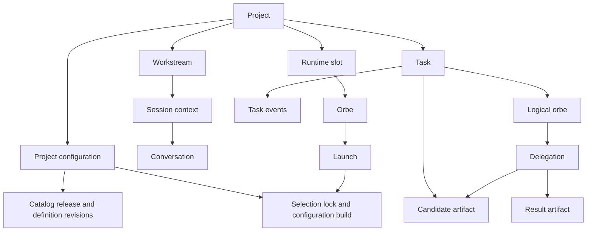
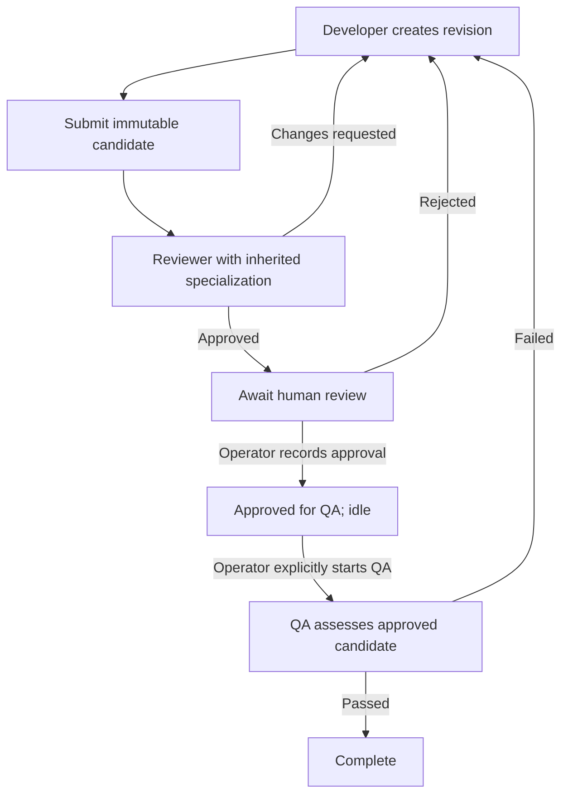

# Entities and human-controlled review workflow

Analysis date: 2026-10-30. This records the original analysis. The subsequent engine implementation now enforces unlimited submissions, reviewer handoff, human decisions and operator-only QA. See [current task workflow](task-orchestration.md). Reviewer specialization inheritance remains planned; descriptions of the old parallel workflow below are historical.

## Existing entities

| Entity | Meaning and relationship |
| --- | --- |
| Project | Registered checkout; owns configuration revisions, tasks, conversations and workstreams. |
| Definition / DefinitionRevision | Versioned instructions and metadata for profiles, specializations, capabilities and other catalog entries. |
| CatalogRelease / ReleaseMember | Published collection of definition revisions. This is separate from an application package release. |
| ProjectConfiguration / ProjectOverrideRevision | Immutable project selection of catalog release, captured project context, aliases and overrides; project points to its active configuration. |
| SelectionLock / ConfigurationBuild | Resolved selection and rendered configuration used to prepare a launch. |
| Workstream | Project + profile + optional key; groups persistent activity across specialization contexts. |
| SessionContext | Workstream + specialization; can link a conversation. |
| Conversation / ConversationEvent | Provider-independent history and ordered events; not the task's workflow state. |
| OrbeSlot / Orbe / OrbeLaunch | Runtime selection slot, persistent runtime home, and individual launch attempt. Launch records configuration/build and execution status. |
| Task | Persisted coordination record for project + task key: workspace, developer owner, state, candidate, optimistic-concurrency version, submission count and limit. |
| LogicalOrbe | Task participant with profile, specialization and optional parent. Separate from a provider process or runtime home. |
| TaskArtifact | Immutable, content-addressed evidence. A candidate is an artifact kind, not a separate database entity. |
| Delegation | Parent-to-child assessment of one candidate with frozen context, execution status and result artifact. |
| TaskEvent | Ordered audit trail of task transitions. |
| Knowledge | Original task-scoped, versioned knowledge proposal pointing to an artifact; project acceptance is explicit. |
| MemoryOwner / MemoryThread / KUnitRecord / KUnitRevisionRecord | Knowledge ownership, threads, durable knowledge units and their revisions in the newer memory layer. |
| MemorySource / KUnitEdge / KnowledgeMetadata | Idempotent source attribution, knowledge relationships, typed evidence and audience metadata. |
| MemoryBinding / MemoryRead | Bound memory access context and read receipts. |
| MemoryCapture / MemoryState / MemoryIndexJob | Capture processing, memory state and index maintenance. Index state is separate from task approval. |

These edges summarize ownership and references, not every foreign key. Logical orbe identity and runtime orbe identity must not be conflated.

## What a task currently means

A task is a durable workflow container, not a chat, user message, Git commit or operating-system process. It can survive several developer sessions and contain multiple submitted candidates and assessments. Its `version` is a concurrency counter; it is not a source revision or package version. `rounds` counts submissions, not model reasoning turns or tool calls.

`Coordinator.ensure_orbe` derives task identity from project and task key. An omitted key becomes the empty key, so unrelated unkeyed requests can accumulate in the same task and exhaust its submission budget. Use a distinct task key per change today. The proposed CLI should expose this identity and remaining budget clearly rather than silently introducing another task lifecycle redesign.

## Existing workflow gaps

The current policy requires reviewer approval and QA pass on the same candidate for completion. Runtime instructions request parallel delegation. Single-role calls exist, but their allowed states do not enforce a human approval prerequisite. There is no human approval receipt. Reviewer children currently receive an empty specialization, and only developer specialization definitions currently exist.

Remote artifact references are syntactically pinned URI/revision pairs, not verified pull-request approval integrations. A PR URL by itself must not become evidence that a specific head was approved. Likewise, successful process exit is not a structured assessment result.

## Proposed workflow

Blocked executions retain their stage and require explicit recovery. Reviewer completion ends the automated development/review run. The task remains awaiting human approval; this avoids misreporting overall completion before QA. Human approval does not launch QA. The user explicitly selected an operator CLI command as the QA launch interface.

Record human approval against the exact candidate and source digest, with operator attribution and reviewer result. New source requires a new candidate, review and human approval. QA must consume the approved candidate. Release publication remains a separate operator-authorized action.

Reviewer specialization defaults to the developer's effective specialization, unless the project's pinned configuration explicitly overrides it. Preserve reviewer permissions and role instructions: inheriting Python expertise must not turn a reviewer into a developer. Fail before launching if the effective reviewer specialization cannot resolve.

## Deterministic boundary

Software validates configuration, resolves identity and specialization, captures revision evidence, checks prerequisites and budgets, schedules one assessment, freezes context, launches the selected adapter, validates structured results and records transitions. Models perform implementation, code review and exploratory QA judgment. Stable tests, revision comparisons and approval checks must not be delegated to model inference.

Local operator approval is an audited attestation. Because agents currently have full-access execution under the same OS account, hiding approval from MCP does not make the CLI inaccessible to an agent. Do not claim a hardened human-only boundary. Enforced separation would require a separately authenticated approval service or a verified external human review integration; that is a separate architectural change.

## Supporting source

- `src/orbehelm/infrastructure/persistence/models.py`: entity fields and relationships.
- `src/orbehelm/product/coordination.py`: task identity, submission, child creation and assessment aggregation.
- `src/orbehelm/domain/coordination/policies.py`: submission/delegation guards and current completion policy.
- `src/orbehelm/delegation_runner.py`: assessment scheduling, materialization and launch.
- `src/orbehelm/mcp_bridge.py`, `src/orbehelm/product/coordination_commands.py`: model and operator interfaces.
- `src/orbehelm/coordination_runtime.py`, `definitions/profiles/`: injected protocol and authoritative role definitions.
- [Implementation plan](../plan/refactor-human-approved-review-qa-1.md).
