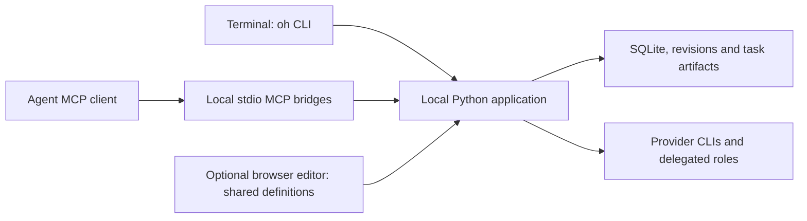

# OrbeHelm operator guide

Verified against source release `0.1.0a4` on October 30, 2026. This guide explains
existing behavior; it does not change application settings or start agent processes.
At inspection, the installed `oh --version` reported `0.1.0a2`, while the checkout's
`./oh --version` reported `0.1.0a4`. Published source and installed application are
separate. Existing running agents/MCP processes also retain their loaded runtime.

**What OrbeHelm currently is**

OrbeHelm is a local application for composing agent definitions, launching persistent
agent sessions, coordinating development tasks and storing technical knowledge.
The CLI, coordination MCP, memory MCP and optional browser editor use local Python
application services and SQLite/filesystem persistence. Ordinary CLI/MCP work needs
no HTTP server.



| Capability | Current behavior |
| --- | --- |
| Instruction composition | Base, profile, specialization, skillsets and project context produce provider-specific instructions/configuration. |
| Skills and MCP registration | Select registered local/public remote skills and MCP servers; selected dependencies become part of generated configurations. Registering an MCP does not install or authenticate its executable. |
| Persistent sessions | Native Codex/Claude and managed `oh chat`; recorded identities, resume, new generations and bounded historical handoffs. Exact provider context is not transferable. |
| Project configuration | Registered projects, shared source revisions, project-local replacements, history/diff/rollback and immutable source snapshots. |
| Task coordination | Owner developer submits a candidate; reviewer and QA assess the same revision independently, normally in parallel. Results and integrity checks control task state. |
| Knowledge and history | Separate conversation ledger and typed, revisioned memory; keyword retrieval plus optional local semantic search. |
| Lifecycle and installation | Auth setup, diagnostics, session listing/close/prune, staged installation/update and explicit schema migrations. Prune deletes selected native session data and requires confirmation. |
| Optional editor | Shared definitions, library and source history; not a general project/task/orbe dashboard. |

Persistent native OpenCode resume is not supported. Its renderer and one-shot
configured delegation path remain available. The source is still alpha: it does
not promise exclusive host isolation, generic autonomous workflows, arbitrary
recursive role delegation or cross-machine memory synchronization.

The repository's GitHub release workflows are separate automation. `oh` has no
built-in `publish` command. The recent commits, tag pushes and release publication
were Git/GitHub CLI operations performed by the assistant under the release requests.

**What “Called orbehelm.read_context” means**

It is an MCP tool call. `orbehelm` is the registered coordination server name;
`read_context` is its tool. The agent host displays that invocation in its UI.

OrbeHelm adds the server to the launched agent's generated runtime configuration.
Internally it starts Python with the `mcp-serve` CLI subcommand and a fixed actor,
agent and configuration binding. Tool requests then use JSON-RPC over standard
input/output; an HTTP listener is unnecessary. The tool does not shell out to
`oh tasks context` for each read. Both interfaces call the same coordination code.

Terminal equivalent:

```sh
oh tasks list --project=/path/to/project
oh tasks context --project=/path/to/project --actor=LOGICAL_ORBE_ID
```

Use the logical actor returned by `tasks list`, not a native session/orbe ID.

| Coordination MCP tool | Effect |
| --- | --- |
| `read_context` | Read state, workflow version, current candidate, knowledge references, delegation statuses and events. No model launch and no new submission round. |
| `read_artifact` | Read a verified, accessible artifact record and its file manifest. |
| `submit_work` | Freeze explicit source/requirements/handoff as a candidate; consumes one submission round. |
| `delegate` | Start authenticated reviewer/QA native model processes; parallel mode starts both required assessments. |
| `complete_delegation` | A bound child stages its structured result; successful exit and unchanged inputs are required before acceptance. |
| `save_knowledge` | Save typed task knowledge or a project knowledge proposal in the coordination system. |
| `reopen_task` | Reopen a completed/blocked task; this MCP tool cannot raise the submission cap. |

The separate `orbehelm_memory` MCP exposes `search_memory`, `read_memory` and
`save_memory`. Its launch binding fixes owner/scope. These tools cannot choose
another owner or become operator maintenance tools.

**What initiates a flow**

The engine exposes operations and enforces state; the agent chooses operations
under its supplied instructions. `read_context` does not itself launch reviewers,
commit code or publish a release.

In this project, `definitions/profiles/developer.md` requires same-candidate
reviewer/QA assessment when coordination tools are available. In addition,
`coordination_runtime.py` injects an explicit submit/delegate/complete protocol into
the runtime. These instructions explain the assistant's repeated MCP calls. They
are separate from both user launch defaults and enforced database/policy limits.

A typical task proceeds as follows:

1. Launch with project/profile/spec/task key. Resolve definitions, generate runtime
   configuration and attach scoped MCP servers when memory/task integration is enabled.
2. The developer works in the selected workspace and reads task context.
3. Submission freezes source bytes, acceptance criteria and configuration identity.
4. Parallel delegation creates separate reviewer/QA identities and materialized
   working copies of the same candidate. Authentication/dependencies are prerequisites.
5. Each child returns structured findings and evidence through its bound MCP tool.
6. The runner checks completion, exit status and submitted-input integrity. Both
   required gates must pass the same candidate. Changed source needs a new candidate.

There is no universal “publish automatically after QA” rule in the task engine.
Repository GitHub Actions create a draft after a version tag passes checks; publication
is a separate authorized operation. Agent calls and those external actions are visible
in the conversation rather than being implicit consequences of a context read.

**User defaults: `.orbehelmrc`**

The file is INI, not JSON. Example:

```ini
[ORBEHELM]
agent = codex
profile = developer
spec = python
memory = true
strict = false
```

Choose another file with `oh --config=/path/to/config.ini` or `ORBEHELM_CONFIG`.
An explicitly selected missing file fails. Configuration reads never create a file.
Use `[ORBEHELM]`, not INI `[DEFAULT]`.

| Supported key | Meaning / override |
| --- | --- |
| `root` | Definitions/application storage root; `--root`. Advanced: changing roots can select another database. |
| `agent` | Provider CLI; `--agent`. |
| `profile` | Role definition; `--profile`. |
| `spec` | Specialization; `--spec`. |
| `project` | Project directory; `--project`. Empty/omitted uses current directory. |
| `skillsets` | Comma-separated named bundles; CLI uses singular `--skillset`. |
| `skills` | Comma-separated skill names; `--skills`. |
| `strict` | Exclusive-context request; not an implemented isolation mode. Native strict runs refuse to launch. |
| `memory` | Enable memory/task integration; `--memory` or `--no-memory`. Default true. |

`[SKILLS]` optionally maps names to local skill directories or supported public HTTPS
sources. Relative paths resolve against the configuration file's directory.

CLI values replace user defaults. For example `--spec=` clears the configured
specialization and `--skills=` clears directly selected skills, not dependencies
required by definitions. Root precedence is CLI, environment root, user file, running
source root. The installed launcher exports its installation root, so `--root` is the
explicit way to select a different one. Other defaults use CLI, user file, built-ins.

There are no supported rc keys named `max_rounds`, `round_limit`, `memory_visibility`,
`review`, `coordination` or `model`; unknown keys are rejected. Do not treat runtime
identity variables such as `ORBEHELM_PROFILE` as general launch configuration knobs.

**Project inputs and behavioral policy**

A project's `orbehelm.project.json` supplies a composition layer:

```json
{
  "schema_version": 1,
  "instructions": ["instructions.md"],
  "skills": [],
  "mcp": []
}
```

This declares project context/dependencies, not task round limits. Paths resolve
against that project. Parent directories are not searched. Registered project
context is snapshotted; use `oh projects refresh --project=/path/to/project` after
external edits.

Reusable sources are in `definitions/base`, `definitions/profiles`,
`definitions/specializations`, `definitions/skillsets` and `registry`. Use typed
CLI operations such as `get`, `override`, `reset`, `set`, `history` and `diff` to
manage shared/project configuration. `override`/`reset` are project-local;
`set --global` changes shared definitions. Follow the instruction template rather
than hand-editing generated builds.

Inspect the developer policy with:

```sh
oh get definition.profile.developer --project=/path/to/project
oh get definition.profile.developer --global
```

Changing role text alone does not remove coordination protocol instructions that
are also injected by runtime code. There is currently no independent supported
`--no-review` switch. `--no-memory` removes memory/history handoffs and scoped
memory/task integration in the current launch paths; it is not a review-only switch.

Launches currently request full-access native modes. Separate working copies and
API memory authorization are not a same-user filesystem sandbox. Strict exclusive
isolation remains unsupported.

**Task keys and `max_rounds`**

Use a distinct task key per feature/bug/release:

```sh
oh --agent=codex --profile=developer --spec=python \
  --project=/path/to/project --unique-key=FIX-123 \
  --memory-visibility=project
```

A project/task key selects a task record; workstream identity also includes profile,
context adds specialization, and native sessions add provider/generation. Omitting
`--unique-key` reuses the project's default task. That is why rounds accumulated
across multiple releases in the preceding session: one default task was reused.
Changing specialization or starting `--new-session` does not reset a task's budget.

- `rounds` counts submitted candidates, not tool reads, tests, model tokens or role pairs.
- `max_rounds` is the stored per-task submission ceiling; the source default is 3.
- `version` is a changing concurrency-control counter; it is not the round count or package version.

At inspection, the preceding task was complete with five rounds and a limit of five.
Its limit had been raised explicitly; the global/new-task default was not changed.
There is no initial-budget/default-budget rc or launch setting today.

To inspect and then change an existing task, use a normal operator terminal:

```sh
oh tasks list --project=/path/to/project
oh tasks context --project=/path/to/project --actor=LOGICAL_ORBE_ID
# Replace VERSION with the current numeric version returned above:
oh tasks reopen --project=/path/to/project --actor=LOGICAL_ORBE_ID \
  --expected-version=VERSION --round-limit=10
```

The last command mutates task state: it reopens a completed/blocked task and sets
its ceiling. Pending children must be resolved first. The new limit must exceed
completed rounds and be at most 100. This is not a setting for a fresh/developing
task. Changing the source default is a code change, not a supported rc operation;
never hand-edit the database. The child execution timeout is currently another
code default (300 seconds), not an rc/MCP argument.

**Query memory from a terminal**

Use a normal terminal outside an active agent's scoped environment. Use the same
`oh` installation/root that created the data. Selecting another `--root` or a
checkout launcher can select a different store. Commands return JSON.

Start with the conversation selector:

```sh
oh conversations list --project=/Users/sergiovazquez/Projects/orbe-helm
```

Choose an `id` whose `selection` matches the desired profile, specialization and
`unique_key`. Then replace `CONVERSATION_ID` below:

```sh
oh memory query --project=/Users/sergiovazquez/Projects/orbe-helm \
  --thread=CONVERSATION_ID --query='Python 3.11 memory fix' --limit=10

oh memory list --project=/Users/sergiovazquez/Projects/orbe-helm \
  --thread=CONVERSATION_ID

oh memory show UNIT_ID --project=/Users/sergiovazquez/Projects/orbe-helm \
  --thread=CONVERSATION_ID

oh memory history UNIT_ID --project=/Users/sergiovazquez/Projects/orbe-helm \
  --thread=CONVERSATION_ID
```

`UNIT_ID` comes from query/list. Memory query limits are 1–50. An existing logical
actor can be selected with `--actor` instead of `--thread`; conversation selection
also resolves the recorded memory-owner mapping. Private units from another context
are not automatically shared. Project/global/audience rules still apply.

Conversation history is separate from knowledge:

```sh
oh conversations search --project=/Users/sergiovazquez/Projects/orbe-helm \
  --thread=CONVERSATION_ID --query='Python 3.11'
```

That searches captured conversation events; `memory query` searches typed technical
outcomes. Arbitrary replies are not automatically accepted knowledge. Typed units
include decision/architecture/feature/review/test/constraint, evidence, revision and
source identity. Agent writes are reported outcomes, not automatic proof of truth.

New contexts default to private knowledge. `--memory-visibility=project` shares new
eligible outcomes within the project, subject to provenance and audience. It does
not reclassify older private units. Global means across projects in this installation,
not internet publication or cross-computer synchronization.

**Memory maintenance and installation**

In an operator terminal:

```sh
oh memory status
```

To update an installed application, first finish active agent sessions and stop the
optional editor, then run from the reviewed source checkout/tag:

```sh
./update.sh --memory
oh --version
```

Retain the original `--install-dir` if customized. This changes the installed
application; publishing a GitHub release alone does not. Setup/update installs
optional packages but never downloads model weights automatically.

For an existing configured/cached model after a dependency update:

```sh
oh memory configure
```

For first-time semantic setup instead:

```sh
oh memory configure --download-model
```

Configure checks local document/query inference and activates indexing. `memory status`
and a representative `memory query` should confirm retrieval. Keyword-only search
needs no embedding model. Semantic retrieval uses local FastEmbed/ONNX inference;
indexing can report pending work. Explicit recovery commands include `memory reindex`
and `memory reindex --rebuild-index`.

Maintenance is intentionally unavailable through an agent binding. Do not remove a
live binding to bypass that boundary. This session's existing memory MCP search client
reported that embedding configuration changed and the client must restart. Restart
the agent/MCP process to reload its runtime; a published version does not refresh an
already-running client. The operator commands above were checked against source,
not executed on the live memory store for this guide.

**Configuration surface still has gaps**

Launch defaults are centralized, but workflow budgets, injected review policy and
child timeouts are not all user-configurable settings. There is no all-purpose
orchestration-policy section in `.orbehelmrc` yet. Editing profiles, changing task
state and changing application policy are distinct operations. This guide adds no
new options and changes none of those policies.

**Sources**

- [User configuration parser](../src/orbehelm/configuration.py)
- [CLI arguments and dispatch](../src/orbehelm/cli.py)
- [Coordination MCP](../src/orbehelm/mcp_bridge.py)
- [Injected coordination protocol](../src/orbehelm/coordination_runtime.py)
- [Developer profile](../definitions/profiles/developer.md)
- [Task model](../src/orbehelm/infrastructure/persistence/models.py)
- [Workflow policies](../src/orbehelm/domain/coordination/policies.py)
- [Memory CLI](../src/orbehelm/memory.py)
- [Memory MCP](../src/orbehelm/memory_bridge.py)
- [Current persistent-workflow contract](persistent-workflows.md)
- [Current memory guide](knowledge-memory.md)
